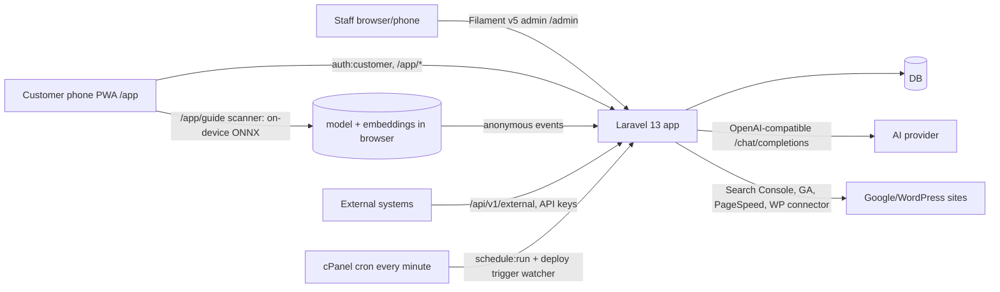

# CONTEXT — the project brain

Snapshot 2026-11-06. Labels: `CONFIRMED` (seen in repo/CI/session), `INFERRED`, `UNKNOWN`, `NOT TESTED`. Counts are from the working tree at this snapshot.

## 1. Overview
- **What:** a Persian (fa, RTL, Jalali) all-in-one operations system for one Iranian tourism/hospitality group (CONFIRMED by code + owner conversation). Internal name «سامانه مدیریت یکپارچه»; customer brand «گنجنامه» (Ganjnameh — a cave/museum attraction near Hamedan, INFERRED from content; production domain appears to be `farsiwp.ir`, seen in an owner screenshot, NEEDS VERIFICATION).
- **Audience:** staff (admin panel, mobile-friendly), managers, and public customers/tourists (PWA `/app`, smart guide).
- **Stage:** mature, feature-rich, in production on a shared host; developed phase-by-phase by AI (Claude Code) with the owner approving each PR by saying «مرج کن». ~250 merged PRs (`git rev-list --count origin/main` = 256 commits; PR numbers up to #250 merged, #251 open).

## 2. Technology stack (CONFIRMED from `composer.json`, `package.json`, `.github/workflows/tests.yml`)
| Layer | Tech |
|---|---|
| Runtime | PHP target **8.4** (composer says `^8.3`, but `spatie/laravel-activitylog` requires `^8.4`; CI matrix 8.4 + 8.5). Sandbox has 8.3 — cannot boot the app. |
| Framework | Laravel **13.17+**, Filament **5.8**, Livewire 4 (via Filament), Tinker 3 |
| Auth/permissions | `spatie/laravel-permission` 8.3 (dynamic RBAC), separate `customer` guard for PWA |
| Other PHP libs | `spatie/laravel-activitylog` 5.1, `spatie/laravel-medialibrary` 11.23, `laravel-notification-channels/webpush`, `morilog/jalali` + `mokhosh/filament-jalali`, `smalot/pdfparser`, `thiagoalessio/tesseract_ocr` (OCR), `openspout` (Excel; present in `composer.lock`, pulled in transitively — not a direct `composer.json` requirement; used via `app/Filament/Support/TableExports.php`) |
| Dev | PHPUnit 12, Pint, Faker, Mockery, Collision, Pail, `laravel/boost` (MCP; currently fails to connect in sandbox) |
| Frontend | Vite 8 + Tailwind 4 (no React/Vue). Libraries: chart.js, d3, leaflet 1.9.4, qr-scanner, qrcodejs, three/3d-force-graph (war-room view). Second Vite config `vite.war-room.config.js`. |
| DB | `.env.example`: sqlite default, `SESSION_DRIVER/QUEUE_CONNECTION/CACHE_STORE=database`. Production engine UNKNOWN (likely MySQL/MariaDB). Tests: sqlite in-memory. |
| Smart guide runtime | `onnxruntime-web` 1.22.0 (WASM, vendored) + DINOv2-small int8 ONNX (~23 MB) in `public/vendor/guide/` |
| Hosting | cPanel shared host, **no terminal/SSH, `proc_open` disabled**, no persistent queue worker (see `DEPLOYMENT.md`) |

## 3. Architecture

- **Admin UI:** Filament panel (resources = CRUD modules; pages = tools/dashboards). ~66 resource folders, 51 pages, 15 widgets, 182 models, 90 enums, 254 migrations, 24 jobs, 20 artisan commands, 51 controllers, 132 Blade views, 288 test files.
- **Domain layer:** `app/Domain/{Ai,Crm,CustomerApp,Deployment,DigitalProjects,Hospitality,Payments,Seo,System,Ticketing,TripPlanner,WebApp,Webhooks}`.
- **Public surfaces:** `/app` PWA (`CustomerAppController`, `CustomerApp\*` controllers; service worker `public/customer-app-sw.js`), `/pay/*`, `/checkin/*`, `/feedback/*`, `/trip/{token}`, `/lead/{slug}`, `/system-guide`, guide endpoints, print/export routes under staff `auth`.
- **API:** `routes/api.php` → `/api/v1/external/*` (products, tickets, discounts, gate scan, rooms/bookings, CRM deals, forms, documents, webhooks) guarded by `external-api.auth` + `external-api.can:<perm>`.
- **Scheduling:** `routes/console.php` (316 lines; ~33 named schedules, e.g. `queue:work --stop-when-empty --max-time=50` every minute, `access-control-sync` daily 03:30 Tehran, hotel morning digest, booking reminders/hold release, SEO syncs, AI scheduled prompts/missions, digital-projects attention digest). All use `Schedule::call(Artisan::call…)` (no subprocess).

## 4. Business modules (by access-control group; labels as shown in the panel)
Counts from `config/access-control.php`.
- **اقامتی و هتلداری (23):** rooms/villas, room types, bookings (+ groups, charges, payments, deposits, holds, cancellation policies, rate plans, promo codes, stay discounts, price rules, channel allotments/sales channels), room blocks («اتاق‌های خارج از سرویس», open-ended allowed), lost items, waitlist, handover notes, today's arrivals/departures, occupancy calendar, **room rack** (`RoomRack` page, live board), night audit, hotel reports, booking message settings. Domain: `StayPricing`, `RoomInventory`, `OccupancyCalendar`, `NightAudit`, `MorningDigest`, `HotelReport`, `WaitlistNotifier`, `LostItemService`.
- **CRM و مشتریان (13):** guests (+ duplicates/merge/importer/mobile normaliser), deals + kanban pipeline + automation rules, lead-capture forms, support tickets with SLA, NPS/feedback, segments, customer value/churn, wallet & cashback, inbox.
- **گیشه بلیط (7):** products/attractions, ticket types, orders/tickets, gates (offline sync endpoints), discounts, gate scan, reports.
- **دستیار هوشمند مدیریتی (7):** AI providers, assistant page + widget, assistants hub (custom assistants/profiles, consultations), mission room/team map, usage dashboard, scheduled reports, WhatsApp link. Domain `Domain/Ai`.
- **مرکز سئو (19):** SEO projects, opportunities, keywords/tracker, content calendar, technical audit, periodic reports, Google connections, sitemap analyser, pillar/cluster map, WP fleet status; WordPress connector plugin in `wordpress-plugin/farsiwp-seo-connector`.
- **پروژه‌های دیجیتال (3):** digital projects grouped by type, actions, daily reports, status history, weekly stats, management report (A4 landscape), Excel/print, morning digest.
- **Others:** حقوقی و قرارداد (contracts + AI legal assistant), فرم‌ساز و گردش‌کار (forms, approvals), وظایف و پروژه‌ها (tasks/projects/recurring checklists), مدیریت اسناد, حضور و غیاب, ارتباطات داخلی (events, messenger), وب‌اپ مشتریان (banners, sections, bottom menu, login methods, custom domain), تریپ‌پلنر (AI trip planner), زیرساخت سازمانی (companies, departments, users, tags, roles, API accounts, SMS, payment gateway, deploy button, **گزارش خطاهای سرور**, **دادهٔ آزمایشی**).
- **راهنمای هوشمند گردشگری (6)** — see §5.

## 5. Smart tourism guide (experimental; most recent large work)
**Switch:** `GuideSetting::current()->is_enabled` (default **off**). While off: public endpoints 404; signed-in staff with `guide-objects.view_any` can still open the scanner (banner «حالت آزمایش»).
**Tables** (`2026_11_19_100000_create_guide_tables.php`): `guide_sites` (default row «گنجنامه»), `guide_zones`, `guide_objects` (status draft/processing/ready/failed/disabled, category, slug), `guide_reference_images` (`embedding` JSON, status pending/processed/failed), `guide_videos` (path or url, poster, `is_published`, default **true** since PR #244), `guide_events` (anonymous: type, object, confidence, latency), `guide_settings` (singleton: `similarity_threshold` 0.700, `min_margin` 0.030, `frame_interval_ms` 1500, `min_reference_images` 3).
**Panel:** group «راهنمای هوشمند گردشگری»: resources `GuideObjectResource` (relation managers: reference images, videos), sites, zones; page `GuideSettings` (permission `guide-settings.access`); header buttons on the objects list: «پردازش تصاویر مرجع», «آزمون دقت», «باز کردن اسکنر».
**Recognition design:** all inference runs **in the visitor's/staff browser** with onnxruntime-web (WASM, single thread). Model `public/vendor/guide/dinov2-small-q8.onnx` (input `pixel_values` 224×224 ImageNet-normalised, centre-square crop; output `last_hidden_state`). Embedding = L2-normalised concat of [CLS token, mean of patch tokens], then L2-normalised again (`public/guide/guide-engine.js`). Reference embeddings are computed in a staff browser at `/guide/enroll` and POSTed (`GuideReferenceImage::markProcessed`, max 2048 dims, normalised server-side). Matching: best cosine per object; match only if `best ≥ threshold` **and** `best − second ≥ margin`; scanner needs **two consecutive** frames agreeing.
**Routes:** public `GET /app/guide` (`guide.scanner`), `GET /guide/data.json` (throttle 60/min; objects + embeddings), `POST /guide/events` (throttle 240/min). Staff (`auth`): `GET /guide/enroll`, `GET /guide/enroll/pending.json[?all=1]`, `POST /guide/enroll/{ref}`, `POST /guide/enroll/{ref}/failed`, `GET /guide/accuracy` («آزمون دقت»: precision/recall/false-accept with threshold sliders, all client-side).
**Scanner UX** (`resources/views/guide/scanner.blade.php`): full-screen glass UI, 3-step onboarding, reticle, status pill, «در حال لود کردن داستان…» curtain over a blurred frozen frame, story video auto-plays (with sound if the browser allows, else muted + «پخش با صدا»), info sheet, error states. `AudioContext.resume()` on the start tap.
**Offline/prefetch:** `customer-app-sw.js` (cache `ganjnameh-app-static-v2`) caches `/vendor/guide/*` and the engine cache-first; `/guide/data.json` and `/app/guide` network-first with cache fallback. `/app` home shows a «راهنمای هوشمند» card (only when enabled) and **prefetches the ~35 MB model in the background** (skipped on Save-Data/2G; refresh check every 3 days via `localStorage` key `guide-prefetch-at`).
**Vendored files:** `public/vendor/guide/{ort.wasm.min.mjs, ort-wasm-simd-threaded.mjs, ort-wasm-simd-threaded.wasm (~11 MB), dinov2-small-q8.onnx (~23 MB), .htaccess (MIME + 30-day cache)}`.
**State of accuracy:** NOT VERIFIED. Owner reported object recognition working after processing; threshold tuning with real cave photos not done. Risks: low light, similar objects, scale (centre crop only).

## 5b. Training centre
The in-app user guide at `/system-guide` («راهنمای سامانه FarsiWP», `resources/views/system-guide.blade.php`, assets in `public/system-guide-assets/`) is the owner's «مرکز آموزش» (interpretation, see OPEN-QUESTIONS Q14). It has numbered chapters (`ch-00` … `ch-13`, plus `ch-smart-guide`), a table of contents and callouts/feature cards. **Update it with every new capability.**

## 6. Access control (see INSTRUCTIONS §4)
`config/access-control.php` → `SyncAccessControlPermissions` → `DynamicPermissionPolicy`. Guard test `AccessControlCoverageTest`. New modules in the latest work: `guide-*`, `server-error-log` (page), `test-data-tools` (page).

## 7. Operational tools added recently (admin-only, group «زیرساخت سازمانی»)
- **گزارش خطاهای سرور** (`ServerErrorLog`, `App\Domain\System\ServerLogReader`): last 20 entries of the newest `storage/logs/*.log`, tail-read (600 KB), secrets masked, errors-only toggle. Exists because the host has no terminal.
- **دادهٔ آزمایشی** (`TestDataTools`, `DemoDataGenerator`; **PR #251, not yet merged**): creates/removes marked `[تست] ` records (1 room type, 3 rooms, 3 guests, 4 bookings, 1 open-ended block, 1 company, 2 deals); never touches unmarked rows.
- **AssistantFailureReporter** (`Domain/Ai`): catches unexpected exceptions in assistant chat, logs to activity log (`ai_assistant`/`unexpected_error`) and shows the cause to admins.

## 8. AI assistant system (essentials)
Providers in table `ai_providers` (OpenAI-compatible base URL + key, default model); `AiProvider::chatCompletion` (retries transient errors; error text now includes HTTP status/type/code via `describeFailure`). Per-assistant model preference in `AiAssistantModelSetting`. Tool-calling loop in `HasAiAssistantEngine` (5 rounds, time budget); tool selection by `AiToolRouter`; usage cap `AssistantUsage`. Custom assistants (`AiAssistantProfile`, `specialties` is an **array** cast) and consultations. Missions/team chat in `Domain/Ai/Missions`. Known live issue: provider rejects chat requests with `openai_error` although «تست اتصال» passes (see HANDOFF §9).

## 9. Configuration (names only; values never recorded)
From `.env.example`: `APP_*` (NAME, ENV, KEY, DEBUG, URL, TIMEZONE=Asia/Tehran default, LOCALE, …), `DB_CONNECTION`, `SESSION_DRIVER`, `QUEUE_CONNECTION`, `CACHE_STORE`, `LOG_*`, `MAIL_*`, `REDIS_*`, `AWS_*`, `FILESYSTEM_DISK`, `VAPID_PUBLIC_KEY/VAPID_PRIVATE_KEY/VAPID_SUBJECT` (web push), `VITE_APP_NAME`. Other config files: `ai_assistant.php`, `seo.php`, `ticketing.php`, `services.php`, `webpush.php`, `access-control.php`. Provider/API keys for AI, SMS, Zarinpal, Google are stored via panel settings (DB), not `.env` — NEEDS VERIFICATION per integration.

## 10. Integrations
AI provider (OpenAI-compatible), Google Search Console/Analytics/PageSpeed/OAuth, Zarinpal payment gateway, SMS gateway (`SmsSetting`, `SmsChannel`), Web Push (VAPID), WhatsApp Cloud API, Telegram (SEO alerts), WordPress sites via the `farsiwp-seo-connector` plugin, OpenStreetMap tiles (local/configurable after PR #222).

## 11. Known limitations & debt
- README.md (root) is older than the code (see OPEN-QUESTIONS Q9).
- Sandbox cannot run the app or tests; CI is the only verifier.
- Smart-guide accuracy unmeasured; model + runtime add ~35 MB to the repo.
- Dashboard widgets may not be permission-gated (NOT VERIFIED; matters for restricted staff roles).
- Fine-grained permissions for some actions not implemented.
- Daily-journal «post/story» counts for digital projects not implemented (owner never confirmed).

## 12. Glossary
**رک اتاق** live room board · **ورود و خروج امروز** today's arrivals/departures · **بستن روز** night audit · **اتاق خارج از سرویس / RoomBlock** blocked room (may be «تا اطلاع بعدی» = no end date) · **دیپلوی سرور** panel button that triggers production deploy · **مرج کن** the owner's command to merge a PR · **تصاویر مرجع** guide reference photos · **embedding/اثر انگشت** numeric fingerprint of an image · **آزمون دقت** in-browser accuracy test · **گیشه** ticket counter · **وب‌اپ مشتریان** customer PWA.
